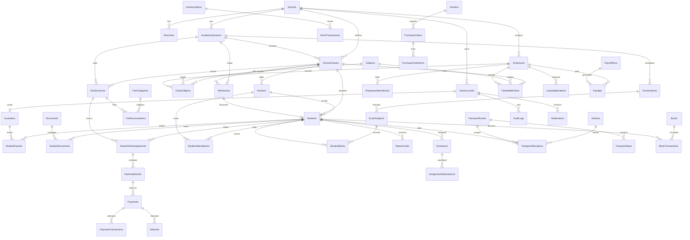

# Entity relationship overview

The physical model contains 55 tables. `database/schema.sql` is authoritative; this diagram shows the
core relationships used by the Phase 1–4 use cases.

## Conventions

- Every table except `Schools` carries `SchoolId`; most also carry nullable `BranchId`.
- `CreatedAtUtc`, `CreatedBy`, `ModifiedAtUtc`, `ModifiedBy`, `IsDeleted` exist on all business tables.
- `RowVersion` provides optimistic concurrency on mutable aggregates.
- Unique indexes are school-scoped, e.g. `(SchoolId, AdmissionNo)` and `(SchoolId, ReceiptNo)`.
- Money is `decimal(18,2)`; percentages `decimal(5,2)`; dates are `date`, timestamps `datetime2`.
- Ledger tables (`Payments`, `Refunds`, `AuditLogs`, `StockTransactions`) are append-only.

## Aggregate roots

| Aggregate | Root | Children |
| --- | --- | --- |
| Organisation | `School` | `Branch`, `AcademicSession`, `SystemConfiguration` |
| Academic structure | `SchoolClass` | `Section`, `ClassSubject` |
| Person | `Student` / `Employee` | documents, guardians, attendance, marks |
| Admission | `Admission` | documents, interview notes |
| Billing | `StudentFeeAssignment` | `FeeInstallment`, `Payment`, `Refund` |
| Assessment | `Examination` | `ExamSubject`, `StudentMark`, `ReportCard` |
| Operations | `Vehicle` / `Book` / `InventoryItem` | allocations, transactions |
